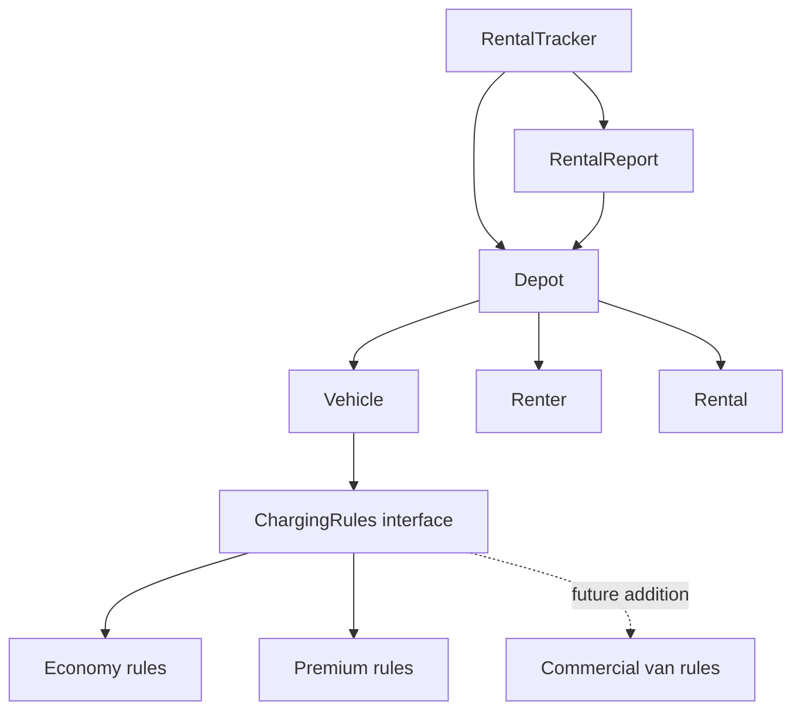

# Dovewing Car Rentals: Diagnosis and Proposed Design

## What the business needs

The depot needs a rental tracker that staff can trust. The rebuild must keep the existing features and calculations, protect rental records, and make it easy to add commercial vans with their own deposit rules.

The most important rule is:

**A vehicle can have only one active rental. It is rented while that rental is active and available otherwise.**

This document diagnoses the original program and outlines the proposed rebuild. Implementation and tests are still to come.

## What happens in the original program

Running the supplied demonstration shows the problem:

1. Kofi rents the Vitz for three days.
2. Ama rents the Prado for two days.
3. The Prado is returned.
4. Ama is allowed to rent the Vitz while Kofi still has it.

The final report lists two active rentals for the same car:

```text
Rental #1: GT-1234-20 -> Kofi Mensah (3 days)
Rental #3: GT-1234-20 -> Ama Owusu (2 days)
```

The valid charges must be preserved: Kofi pays GHS 450 with a GHS 500 deposit, and Ama's Prado rental costs GHS 1,200 with the member deposit waived.

## Problems ranked by business risk

### 1. The same car can be rented twice: critical

**What is wrong:** `Depot.rent()` does not check whether the vehicle already has an active rental. Setting its status to `RENTED` does not stop another booking.

**Root cause:** The program assumes that a vehicle is available instead of enforcing the rule before creating a rental.

**Why it matters:** The depot can promise one physical car to two customers. This can cause failed handovers, disputes, refunds, and lost trust. This is the most dangerous problem because supplying an available vehicle is the business's core service.

### 2. Vehicle availability and rental records can disagree: high

**What is wrong:** `Vehicle.status` and `Rental.status` are stored separately and can be changed independently. Also, `returnVehicle()` closes every active rental with the same registration. After a double booking, one return would close both customers' rentals.

**Root cause:** Two separate records represent the same availability decision, with no single place controlling it.

**Why it matters:** Staff may see a car as available while it is still hired. A return can also hide an outstanding rental, making the report unreliable and encouraging continued use of paper backups.

### 3. Records can be changed from outside the rental process: high

**What is wrong:** Most fields are public. The fleet, renter list, and renter history can be edited directly. `getRentals()` exposes the actual internal rental list.

**Root cause:** The classes expose their data rather than protecting it through controlled operations.

**Why it matters:** Other code can clear rentals, change registrations, or alter statuses without completing a booking or return. A check inside `rent()` alone would not prevent these changes.

### 4. An unknown vehicle category creates a free rental: high

**What is wrong:** Only `ECONOMY` and `PREMIUM` are recognised. An unknown category skips the pricing branches, but the program still creates an active rental with zero cost and deposit. The vehicle status is not updated either.

**Root cause:** Categories are unchecked strings, and rental creation continues even when no pricing rule matches.

**Why it matters:** A spelling error or an incomplete commercial-van addition could lose revenue and make availability contradictory.

### 5. Everything lives in a single file: medium

**What is wrong:** `RentalTracker.java` contains all five classes: `RentalTracker`, `Vehicle`, `Renter`, `Rental`, and `Depot`. The demonstration, data models, rental operations, pricing, and reporting all live in this file.

**Root cause:** The program has grown without clear boundaries between its responsibilities. `Depot` in particular performs several different jobs.

**Why it matters:** It is harder to locate a rule, understand the effect of a change, and hand the project over to another developer. Changes to pricing happen alongside booking and reporting code, increasing the chance of mistakes.

Giving each class its own file will improve navigation. Separating their responsibilities is also necessary; moving the same tightly connected code into several files would not fix the underlying problem.

### 6. Pricing rules are duplicated inside the booking process: medium

**What is wrong:** The economy and premium branches repeat the same calculation, member deposit waiver, status change, and confirmation output.

**Root cause:** Vehicle-specific charging rules are mixed with the shared steps for creating a rental.

**Why it matters:** A rule change can be applied inconsistently, and adding vans requires another branch inside `rent()`. The same method must keep changing even when the booking process itself has not changed. This makes future changes more likely to break existing features.

### 7. Identity and inputs are not protected: medium

**What is wrong:** The depot accepts duplicate registrations and rentals for vehicles or renters that were never registered. Durations and prices are unchecked. Null categories or membership types can cause exceptions. Rentals identify customers by name and vehicles by registration strings.

**Root cause:** Constructors and depot operations do not establish clear rules for valid data and stable identity.

**Why it matters:** Duplicate registrations can cause unrelated rentals to be returned together. Invalid durations or prices can produce misleading charges. Changes to names or registrations can disconnect current details from rental records.

Any additional validation introduced during the rebuild must be documented, because rejecting previously accepted inputs is a behaviour change.

## Proposed design

Each main class will have its own file and a clear responsibility:

| Class or interface | Responsibility |
| --- | --- |
| `RentalTracker` | Set up and run the demonstration. |
| `Depot` | Register vehicles and renters, create rentals, process returns, and determine availability. |
| `Vehicle` | Hold protected vehicle identity and fleet details. |
| `Renter` | Hold protected customer identity and membership details. |
| `Rental` | Hold the rental agreement and its protected lifecycle record. |
| `ChargingRules` | Define how rental cost and deposit are calculated. |
| `RentalReport` | Format and print the report. |

### Design sketch



### Keeping availability consistent

`Depot` will control booking and return operations. Before creating a rental, it will check that the vehicle has no active rental. A rejected booking will leave existing records, history, and ID allocation unchanged.

Availability will be calculated from active rentals. There will be no separately writable vehicle status to contradict those records. Returning a vehicle will complete its active rental while preserving the historical record.

Fields and collections will be private. Callers will receive read-only data that cannot be used to change rental state outside the depot's operations. Vehicle and renter identities will be stable.

### Making commercial vans easy to add

Charging rules will be separate from booking and returns. Economy and premium will keep their existing calculations and member deposit waivers.

A commercial van will use a new implementation of `ChargingRules`, selected when the vehicle is created. Its deposit rules have not been supplied and will not be invented. Booking, return handling, and reporting should remain unchanged.

This approach uses a separate rules object rather than a vehicle subclass because the known difference is how charges are calculated. The original design would require editing `Depot.rent()` and adding another branch containing repeated booking steps.

## Behaviour that must stay the same

The rebuild will preserve:

- Economy and premium rental charges.
- Member deposit waivers.
- Successful rental confirmations and return messages.
- Report ordering and active-rental details.
- The ability to return a vehicle and rent it again, keeping the earlier record.

The deliberate correction is rejection of a second active rental for the same vehicle. The demonstration will handle that rejection and still print the report. Kofi's Vitz rental will remain active; Ama's conflicting rental will not be created.

Valid scenarios will be compared with the original program. Any further behaviour changes will be explained in the design notes.

## One improvement beyond the brief

The additional improvement will be automated regression tests. They will check:

- Both vehicle classes with both membership types.
- Charges, deposit waivers, and valid report output.
- Renting, returning, and renting the same vehicle again.
- Rejection of double booking without partial changes.
- Protection against changes through exposed collections or records.
- A test-only van policy with different deposit rules.

These tests will give the next developer evidence that a pricing change has not broken bookings or returns. They directly address the regression described in the brief.

## Implementation and submission plan

Commit this diagnosis and its diagram before the first source-code change. Make incremental commits during the rebuild so the reviewer can follow the work.

The README will explain the final design choices, any departures from this proposal, and the actual test results. The submitted repository will contain the rebuilt code, this diagnosis and diagram, the tests, the design notes, and the commit history.

## Final submission reconciliation

**Added after implementation, 11 November 2026.** The analysis and design sketch above remain the original pre-build proposal committed in `2bbb2ca`, before source commit `aa94489`. Future-tense statements above describe that proposal, not missing current deliverables.

The final project retains the planned lifecycle ownership, availability derived from active rentals, protected records, separate charging policies, and reporting. The implementation uses responsibility-based packages and a shared enum for the existing economy/premium policies.

Optional rental receipts are the selected extra business improvement. A maintained regression suite is also delivered as verification: 43 cases pass, covering pricing, lifecycle rules, protected data, validation, and combined renter history across depots. It does not automate full report-output comparisons or a successful test-only van policy from the original proposal; report comparisons remain captured manual evidence.

An intermediate implementation limited history to one depot. That limitation was corrected: Renter now derives read-only history across registered depots in booking order, and the suite checks it. Additional validation rejections and source API changes remain intentional differences and are listed explicitly in the README.

See [README.md](README.md) for the completed structure, run commands, final design decisions, receipt usage, exact coverage and limitations, and evidence links. This addendum reconciles the delivered work with the original proposal without changing the original diagnosis or its commit order.
